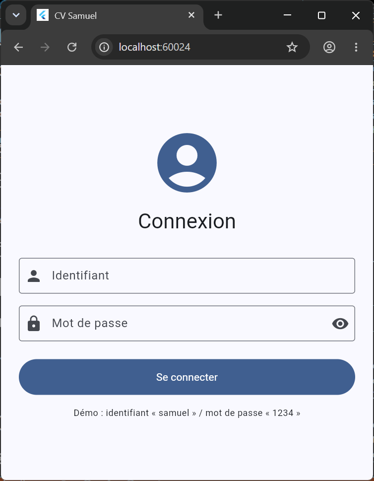
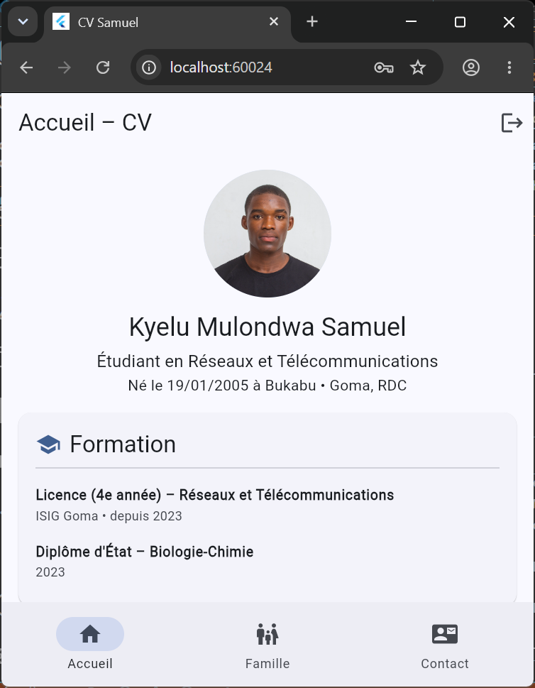
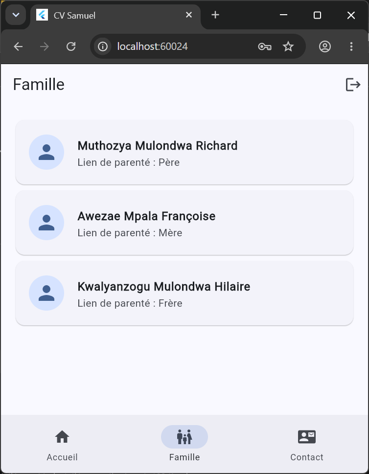
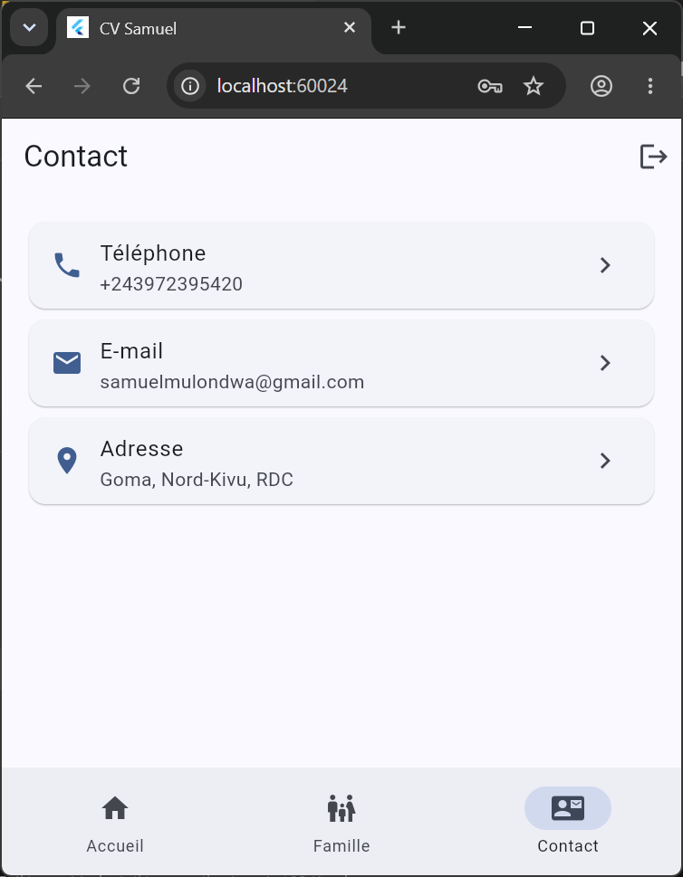
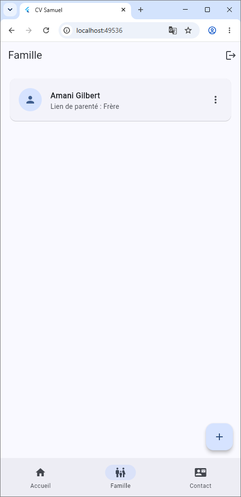
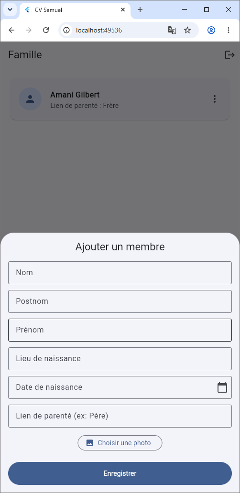
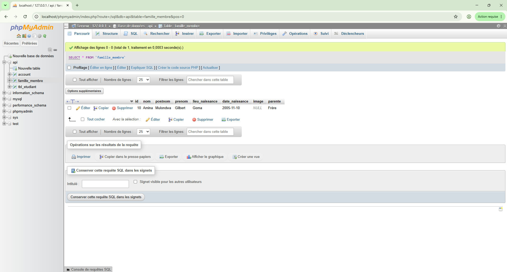

# cv_flutter_samuel

Application mobile Flutter présentant le CV, la famille et les coordonnées de **Kyelu Mulondwa Samuel**.

## Fonctionnalités
- **Connexion** : identifiant + mot de passe masqué + bouton « Se connecter » (démo : `samuel` / `1234`).
- **Accueil** : photo, nom, profil, formation, expériences, compétences, langues, centres d'intérêt.
- **Famille** : liste de cartes (nom, photo, lien de parenté).
- **Contact** : téléphone, e-mail, adresse, LinkedIn, GitHub — cliquables (appel, mail, lien) via `url_launcher`.
- Navigation par `NavigationBar` (barre du bas) + bouton de déconnexion.

## Lancer le projet
```bash
flutter create .        # génère les dossiers android/ ios/ (une seule fois)
flutter pub get
flutter run
```

## Captures d'écran

| Connexion | Accueil (CV) |
|---|---|
|  |  |

| Famille | Contact |
|---|---|
|  |  |


| Formulaire d'ajout  | Liste Membres Famille |
|---|---|
|  |  |


| Base de données
|---|---|
| 

## Démonstration Vidéo

*Voici la vidéo montrant la communication entre l'application Flutter, l'API et la base de données MySQL.*

<video src="docs/screenshots/video_demo.mp4" controls="controls" style="max-width: 100%;">
Votre navigateur ne supporte pas la balise vidéo.
</video>